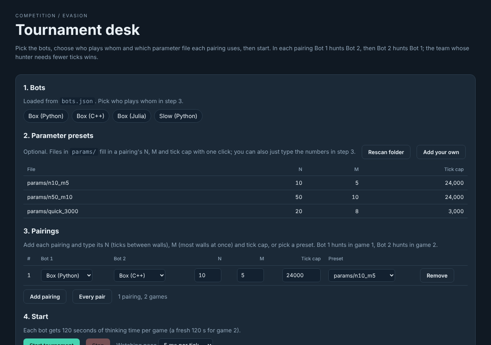
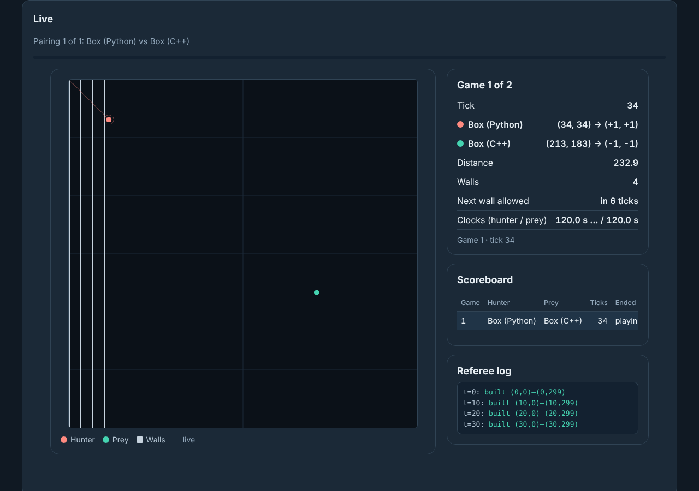
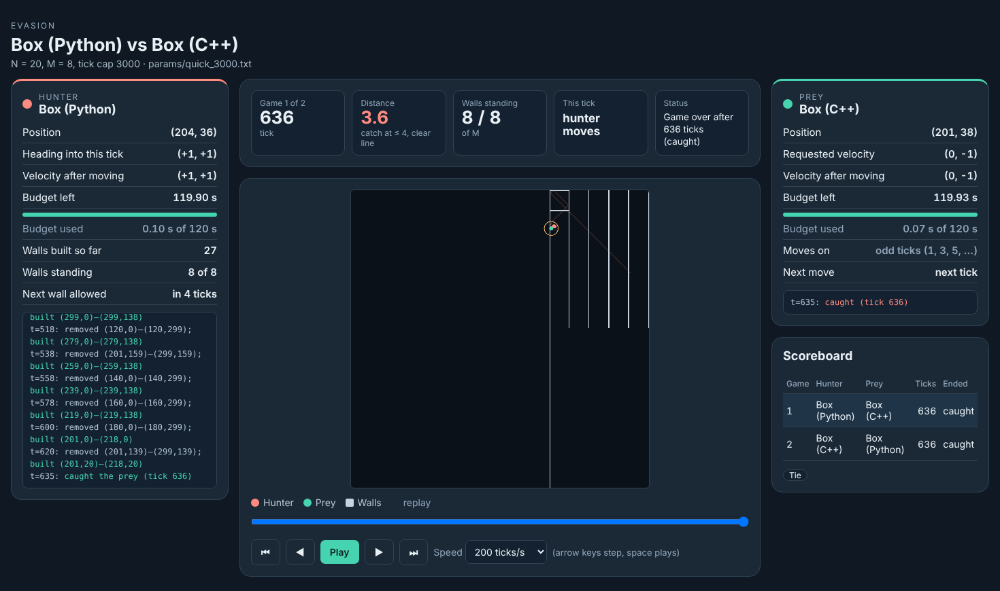

# Evasion

The architecture for the Heuristic Problem Solving game **Evasion** (rules on the course website):
a referee that runs the bots, a live dashboard in the browser, saved replays, and starter bots in
**Python, C++ and Julia**. Same shape as the Kelly architecture: if you built a Kelly bot, you know the drill.

| | |
|---|---|
| **Runs on** | Mac, Linux (including crunchy5) and Windows |
| **Needs** | Python 3.8+, standard library only (nothing to `pip install`) |
| **Clock** | 120 seconds of thinking time per bot per game; bots think one at a time (hunter, then prey) |
| **Arena** | 300 × 300; hunter starts at (0, 0) moving (+1, +1), prey at (230, 200) standing still |
| **Walls** | horizontal and vertical only; N ticks between walls, at most M at once |
| **A pairing** | 2 games: Bot 1 hunts Bot 2, then Bot 2 hunts Bot 1. The hunter that needs fewer ticks wins |

**Contents:** [Quick start](#quick-start) ·
[The dashboard](#the-dashboard) ·
[Other ways to run](#other-ways-to-run) ·
[Making a bot](#making-a-bot) ·
[Rules the referee enforces](#rules-the-referee-enforces) ·
[Requirements](#requirements)

---

## Quick start

```sh
git clone <this repository>
cd evasion
python3 start.py
```

Open **http://127.0.0.1:8091** in your browser. Run this from inside the repository folder. Stop the server with **Ctrl+C**.
(On Windows, type `python` instead of `python3`.)

---

## The dashboard

The page has four steps, then a live view and the results.


*Setup: the bots from `bots.json`, the parameter presets in `params/`, and the pairings you add with their N, M and tick cap.*

<details>
<summary><b>Setting up a tournament, step by step</b> (click to open)</summary>
<br>

1. **Bots** are read from `bots.json`.
2. **Parameter presets** (optional) are read from `params/`. Each file holds **N** (ticks the hunter
   must wait between walls), **M** (most walls standing at once) and optionally the **tick cap**
   (default 24,000). Drop a new file in and press **Rescan folder**, or press **Add your own**.
   From the terminal: `python3 start.py params --n 10 --m 5 --out params/my_game.txt`
3. **Pairings:** press **Add pairing** (or **Every pair** for a round robin), pick Bot 1 and Bot 2,
   and type **N**, **M** and the **tick cap** for that pairing, or choose a preset to fill them in.
   Bot 1 hunts in game 1; Bot 2 hunts in game 2.
4. **Start tournament.** The page scrolls down to the live view. **Stop** ends the run early;
   finished pairings are kept. The **watching pace** lingers a few milliseconds per tick so the
   game is watchable; it never counts against the bots' clocks and you can change it while a game runs.

</details>


*Live view: the arena with the walls, the hunter (red, with its 4-unit catch circle) and the prey (green);
positions, distance, both clocks, the scoreboard and the referee's log of walls built, removed and refused.*


*Replay: the same view with a slider, step buttons (and the arrow keys), **Play** at 10 to 1000 ticks per second,
and both games of the pairing in the scoreboard: click a row to switch.*

<details>
<summary><b>Results and replays</b> (click to open)</summary>
<br>

- Results **add up across runs**: run one pairing now and another later, and both stay in the table.
  They survive a server restart (saved in `results/all_results.json`). **Clear results** starts over
  and keeps a backup copy in `results/`.
- Each run's files are also saved in `results/tournament/<date-time>/`, one folder per pairing:
  `results.json` (every tick of both games) and `replay.html` (self-contained, open it anywhere).

</details>

---

## Other ways to run

<details>
<summary><b>One match from the terminal</b></summary>
<br>

```sh
python3 start.py match "Box (Python)" "Box (C++)" --config params/n10_m5.txt
```

Plays both games and opens the replay in your browser. Add `--no-browser` to skip that.

</details>

<details>
<summary><b>A whole tournament without the browser</b></summary>
<br>

```sh
python3 start.py tournament --config params/n50_m10.txt
python3 start.py tournament --bots "Box (Python)" "Box (C++)"
```

Plays every pair of bots (or the ones you list) and prints each result. Without `--config` it rotates
through the files in `params/`. Results go to `results/tournament/<date-time>/`.

</details>

<details>
<summary><b>On crunchy5</b></summary>
<br>

Clone the repository on crunchy5 and build C++ bots there (a Mac build does not run on Linux).
Start the dashboard on crunchy5:

```sh
python3 start.py --port 8091
```

Then, in a second terminal on your laptop (leave it open):

```sh
ssh -J YOUR_NETID@access.cims.nyu.edu -L 8091:localhost:8091 YOUR_NETID@crunchy5.cims.nyu.edu
```

and open **http://localhost:8091** on your laptop. If 8091 is taken, pick another number in both commands.

</details>

---

## Making a bot

Starter bots are in `bots/templates/` (one file each; `hunter_move` and `prey_move` do nothing until
you write your strategy). A working example in all three languages, **Box** (the hunter walls the
prey into a shrinking box, the prey looks a few moves ahead and keeps its distance), is in `bots/samples/`,
along with **Slow (Python)**, which sleeps 10 s on every turn so you can watch the clock rules play out
(`python3 start.py match "Slow (Python)" "Box (Python)" --clock 30` takes about a minute).

<details>
<summary><b>Step 1: Copy a template</b></summary>
<br>

Copy the folder for your language into `bots/` under your own name:

| Language | Copy | Your file |
|---|---|---|
| Python | `bots/templates/python` | `bot.py` |
| C++ | `bots/templates/cpp` | `bot.cpp` (+ `build.py`, which compiles it) |
| Julia | `bots/templates/julia` | `bot.jl` |

For example: `bots/templates/python` → `bots/alice/`.

</details>

<details>
<summary><b>Step 2: Write <code>hunter_move</code> and <code>prey_move</code></b></summary>
<br>

Your file has a section marked `EDIT ONLY THIS SECTION`. You play both roles, so write both functions.
You may add helper functions and imports there. The rest of the file talks to the referee; leave it alone.

Every tick, both functions receive the state `s`:

| Field | Meaning |
|---|---|
| `role` | `hunter` or `prey` |
| `N`, `M`, `tick_cap` | the parameters of this game |
| `tick` | time steps completed so far. The hunter is asked every tick; the prey only on odd ticks (1, 3, 5, ...) |
| `hunter`, `prey` | each with `x`, `y`, `vx`, `vy` (velocity components are −1, 0 or 1) |
| `last_wall` | the tick the last wall was built, or none |
| `walls` | the walls standing now, each `[x1, y1, x2, y2]` |
| `time_used` | seconds your bot has spent thinking so far this game, timed by your own bot |

**The hunter** returns walls to remove and at most one wall to build. In Python that is a dict,
`{"remove": [[x1, y1, x2, y2], ...], "create": [x1, y1, x2, y2]}`, either key optional and `{}` for nothing.
Removals happen first, then the build, then everyone moves. A wall that breaks a rule is not built
and you are not penalised (the reason shows up in the referee log).

**The prey** returns a new velocity `(vx, vy)` with each component −1, 0 or 1, or nothing to carry on
as it is. Velocities with 0 in both components mean standing still.

Above the editable section every template carries copies of the referee's own rules, `bounce`
(one step of a player, with the exact bounce behaviour), `wall_cells`, `can_build` and `longest_wall`
(the longest horizontal or vertical wall you can build from where you are), so you can look ahead without
guessing how the referee will move you.

The Python starter looks like this:

```python
def hunter_move(s):
    # TODO: your hunter strategy here
    return {}

def prey_move(s):
    # TODO: your prey strategy here
    return None
```

Do not print to standard output: it carries your moves. Print debugging output to standard error.

</details>

<details>
<summary><b>Step 3: Add your bot to <code>bots.json</code></b></summary>
<br>

`bots.json` is the roster: the referee runs exactly the bots listed there. Add one line for yours:

```json
{"name": "Alice", "cwd": "bots/alice", "command": ["{python}", "bot.py"]}
{"name": "Bob",   "cwd": "bots/bob",   "command": ["./bot"], "build": ["{python}", "build.py"]}
{"name": "Carol", "cwd": "bots/carol", "command": ["julia", "-t", "auto", "--startup-file=no", "bot.jl"]}
```

- `name`: shown on the dashboard; must be unique.
- `cwd`: your bot's folder. `command`: how to start it, run from that folder. `{python}` means the Python
  running the referee; `./bot` becomes `bot.exe` on Windows.
- `build` (C++): compiles your bot before the tournament (not timed), and again only when your files change.

Restart the server (or refresh the page) and your bot appears in the pairing menus.

For the organiser: any folder dropped into `bots/` that contains a `bot.py`, `bot.jl` or `bot.cpp` is
**picked up automatically** under the folder's name (press **Rescan folder** or refresh the page). For a
bot with a different layout, or to rename one, add an entry to **`bots.local.json`** (same format as
`bots.json`, next to it). Those folders and that file are ignored by git, so the players' bots never end
up in the public repository.

</details>

<details>
<summary><b>Step 4: Test it</b></summary>
<br>

Play against a sample bot:

```sh
python3 start.py match "Alice" "Box (Python)" --config params/n10_m5.txt
```

Run the automated checks (rules, referee, templates):

```sh
python3 -m unittest discover -s tests -v
```

The Julia check is skipped if Julia is not installed.

</details>

<details>
<summary><b>Step 5: Hand it in</b></summary>
<br>

Send me your whole bot folder, your bot's name, your language and version, and any setup steps.
If your bot needs anything beyond the standard library (for example numpy), tell me before the competition.

</details>

---

## Rules the referee enforces

This is the course's rule page made exact. Where the page leaves something open, the choice is stated here.

- **The arena** is the 300 × 300 grid of integer cells (0, 0) to (299, 299); the hunter starts at (0, 0)
  moving (+1, +1) and the prey at (230, 200) standing still. On the display, y grows downwards.
- **Time steps** are numbered from 0 (the `tick` in the messages is how many have been completed).
  Every step: the hunter's wall removals and build happen first, then the hunter and the prey move at the
  same moment. The prey moves only on odd steps (1, 3, 5, ...) and is only asked on those; on even steps
  only the hunter is asked. A velocity sent on a hunter-only step is never seen.
- **Walls** are **horizontal or vertical only** (no diagonal walls this year), given by their two end
  points, `[x1, y1, x2, y2]`, in either order. A wall occupies the cells on the segment, one cell thick.
  Any length is fine, down to a single cell. A wall must lie inside the arena.
- **Building a wall** needs all of: at least N ticks since the last wall was built (the first is free);
  fewer than M walls standing after this step's removals; the wall touches the hunter's current cell;
  it does not touch the prey's cell; it shares no cell with a standing wall (touching end to end or
  side by side is fine); and it does not **squish** the hunter: with the new wall in place the hunter
  must still be able to move this step. Otherwise the wall is not built, the reason is logged and
  nothing else happens; the cooldown is not consumed.
- **Removing walls** is free at any time, any number per step, and happens before the build of the same step.
- **Bouncing** follows the rule page's pixel algorithm, on the set of blocked cells (the four sides and
  every wall cell). A diagonal mover whose target cell is blocked first looks at the two cells next to
  both it and the target: both blocked → it stays put and reverses both components; only the one in its
  row blocked → it moves vertically and reverses x; only the one in its column → it moves horizontally
  and reverses y; neither → it looks at the cells beyond the target in each direction and decides the same
  way, a lone cell counting as a corner (reverse both). A straight mover (the prey going horizontally or
  vertically) into a blocked cell stays where it is and reverses. All of the page's worked examples are
  in `tests/test_game.py`. Note one consequence: two walls that only meet at a corner leave a diagonal
  gap a player can pass through, exactly as on the rule page.
- **The catch**: after a step, if the hunter is within 4 units of the prey (Euclidean) and no blocked cell
  lies on the straight line between them (Bresenham), the prey is caught. The score is the number of
  steps completed.
- **The tick cap** (24,000 by default, set in the parameter file) ends a game with the prey free: that
  is the hunter's score. The rule page also says the prey's clock running out ends the game, so:
- **Clock**: 120 seconds of thinking per bot per game, a fresh 120 s for game 2. The bots think **one at
  a time**: on a prey step the hunter is asked first and, once it has answered, the prey is asked (it
  gets the same state, not the hunter's answer). Each bot is timed from its own message to its own reply,
  so a slow bot never costs the other any clock, and neither competes with the other for the machine.
  Both requests are then carried out in the same step: walls first, then both move at once. A **prey** that runs out of time, crashes, answers with
  something that is not a JSON object or prints more than 64 KB in one reply is **caught at that tick**.
  A **hunter** that does any of those ends the game with its **score set to the tick cap**, exactly as
  if the prey had never been caught. If both bots fail on the same tick, the prey's failure is what
  counts: it is caught there and the score is that tick.
- **Free startup:** each bot gets up to 30 seconds to start (not on its clock), enough for Julia to compile.
- **New process every game:** your bot keeps its variables between ticks of a game, but not between games.
- **Invalid requests** (a wall that is neither horizontal nor vertical, a velocity outside −1..1, a malformed
  `remove` list) are ignored and logged; they do not end the game.
- **A pairing** is two games with the same parameters, each bot hunting once. The bot whose hunter needed
  fewer ticks wins the pairing; equal is a tie (so a hunter that ran out of time and one that merely
  never caught the prey score the same).

<details>
<summary><b>The messages between the referee and a bot</b> (for the curious; the templates handle this)</summary>
<br>

One JSON object per line. The referee's messages are flat (no nested objects) so a minimal parser does:

```
referee -> bot   {"type":"start","protocol_version":1,"role":"hunter","N":10,"M":5,"tick_cap":24000,"width":300,"height":300}
bot -> referee   {"ready":true}                                          (not timed, up to 30 s)
referee -> bot   {"type":"tick","tick":7,"hx":7,"hy":7,"hvx":1,"hvy":1,"last_wall":-1,
                  "px":230,"py":201,"pvx":0,"pvy":1,"walls":[0,0,0,299, 5,10,40,10]}
hunter -> referee {"remove":[[0,0,0,299]],"create":[7,0,7,299]}          (timed; {} for nothing)
prey -> referee   {"velocity":[1,-1]}                                    (timed; {} to carry on)
```

`walls` is a flat list of 4 numbers per wall. `last_wall` is −1 until the first wall is built.
The prey receives a `tick` message only on odd ticks. The referee closes the bot's standard input when the game is over.

</details>

---

## Requirements

| Language | Version | How to get it |
|---|---|---|
| Python | **3.8 or newer** | python.org or Anaconda. Check: `python3 --version` (Windows: `python --version`) |
| C++ | a **C++17** compiler (g++ 7+, clang 5+, Visual Studio 2017+) | Mac: `xcode-select --install` (after a macOS update, if linking fails with *unknown architecture*, `build.py` retries with your older SDKs; or set `SDKROOT` to one of `/Library/Developer/CommandLineTools/SDKs/`). Windows: MinGW-w64 (`g++`) or Visual Studio Build Tools. Linux: `g++` |
| Julia | **1.6 or newer** | julialang.org. Check: `julia --version`. Bots are started with `-t auto`, so `Threads.@threads` and friends get every core; the bots never run at the same time, so that is safe |

<details>
<summary><b>What's in each folder</b></summary>
<br>

| Folder / file | What's in it |
|---|---|
| `start.py` | Starts everything: the dashboard, a match, a tournament, or a new parameter file |
| `referee/` | The Python code: `engine.py` (rules), `runner.py` (runs bots, keeps clocks, writes replays), `server.py` (dashboard), `tournament.py`, `match.py`, `make_params.py` |
| `dashboard/` | The web pages (`index.html`, `replay.html`) and the screenshots in this README |
| `bots/` | `templates/` (starter bots to copy) and `samples/` (the working Box bots, and Slow for testing the clock) |
| `params/` | Parameter files: `n10_m5`, `n50_m10`, `quick_3000` (a short practice game) |
| `tests/` | Automated checks |
| `bots.json` | The roster of bots the referee runs |

</details>
